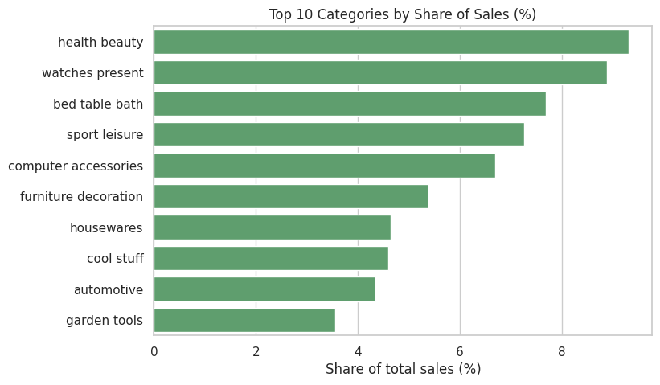
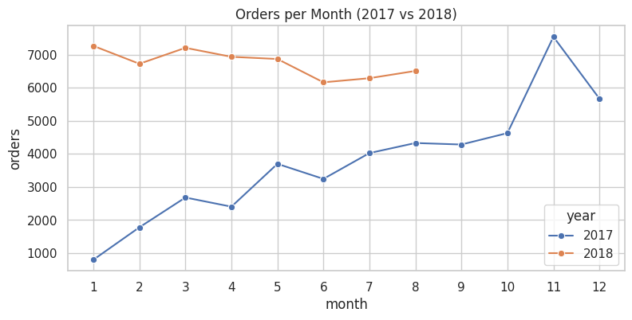
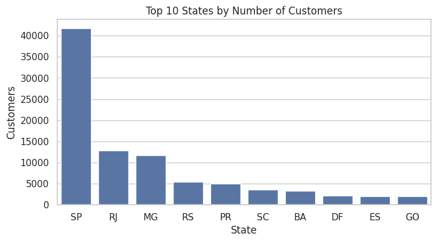
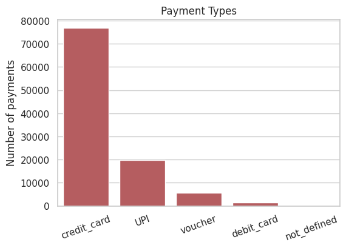
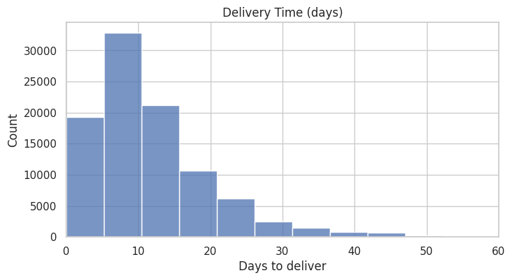

<h1 align="center">🛒 E-commerce Data Analysis</h1>

<p align="center">
  A Python-based exploratory data analysis project focused on understanding online shopping data,
  identifying customer and sales patterns, and transforming raw e-commerce records into actionable insights.
</p>

<p align="center">
  
  
  
  
  
  
</p>

---

## 📖 About the project

Every online order leaves a trail of data behind it: who bought, what they bought, how they paid and how long the package took to arrive. I wanted to see what that trail says about the business, so I took a real e-commerce dataset (about 99,000 orders from 3,000+ sellers) and went through it step by step in Jupyter Notebook.

The main question I tried to answer was simple:

> **How are the customers, sales and products actually performing?**

The data came in 6 separate CSV files and had a fair number of missing values, so a good part of the work was cleaning it before any analysis could start.

---

## 🗂️ Dataset

The raw files are in the `Data` folder (each one is under 25 MB).

| File | What it contains |
|---|---|
| `customers.csv` | Customer city and state |
| `orders.csv` | Order dates and status |
| `order_items.csv` | Products in each order, price and freight |
| `products.csv` | Product category and size details |
| `sellers.csv` | Seller information |
| `payments.csv` | Payment type, value and installments |

---

## 🧹 What I did

**1. Loaded and checked the data.** Read all 6 files with Pandas and looked at the shapes, data types and missing values.

**2. Cleaned it up.** Renamed a column that had a space in it, made the category names consistent, converted the date columns to proper dates and checked for duplicate rows (there were none).

**3. Dealt with the missing values.** Two tables had them: `orders` (4,908 missing values) and `products` (2,448). I handled each one differently depending on what it was:

- Product category: filled with `"unknown"`
- Product weight, size and photo count: filled with the median, since it is not thrown off by extreme values
- Order approval date: filled with the purchase date
- Delivery dates: left empty on purpose. Those orders were cancelled or never delivered, so any date I filled in would have been made up. I added an `is_delivered` column instead

**4. Joined the tables.** Combined orders, items, products and customers into one `sales` table and removed cancelled and unavailable orders.

**5. Explored it with charts.** Bar charts, line charts and a histogram to answer 12 questions about the business.

**6. Saved the results.** Cleaned tables went to the `Data` folder, summary files to `Reports` and the charts to `Images`.

---

## ❓ Questions I answered

**Q1. How many orders were placed in 2017 and 2018?**

➡️ 45,101 in 2017 and 54,011 in 2018.

**Q2. Which state has the most customers?**

➡️ SP, with about 42% of all customers.

**Q3. Which product category earns the most?**

➡️ Health & Beauty, with about 9.3% of total sales. Watches & Gifts (8.9%) and Bed, Table & Bath (7.7%) follow.

**Q4. How many payments are split into installments?**

➡️ About 49%.

**Q5. Does a higher price mean more purchases?**

➡️ Not really. The link is slightly negative (-0.11).

**Q6. How much did sales grow?**

➡️ Sales from January to August 2018 were about 138% higher than the same months in 2017.

**Q7. How long does delivery take?**

➡️ About 12 days on average, with a median of 10.

**Q8. How many customers come back to buy again?**

➡️ Only about 3%.

The notebook covers 12 questions in total, including the top sellers and top customers.

---

## 📊 Charts and what they show

### Top 10 categories by sales



Health & Beauty, Watches & Gifts and Bed, Table & Bath lead the list, with Sport & Leisure and Computer Accessories right behind them. No single category dominates, sales are spread across many of them.

### Orders per month, 2017 vs 2018



November 2017 was the busiest month with roughly 7,500 orders, which fits the shopping season. Through 2018 the order count stayed high from January to August.

### Customers by state



SP is far ahead with about 42% of customers, followed by RJ (about 13%) and MG (about 12%). Nearly half the customer base sits in one state, which makes SP the market that matters most.

### Payment types



Credit card is the clear favourite at about 74% of payments, then UPI at about 19%. Along with that, roughly half of all payments are split into installments.

### Delivery time



Most orders arrive within about two weeks. The average is 12 days and the median is 10, with a small number of orders taking much longer and pulling the average up.

---

## 💡 Main takeaways

1. About 42% of customers live in a single state (SP), so it is the biggest market.
2. Health & Beauty, Watches & Gifts and Bed, Table & Bath bring in the most sales.
3. Customers mostly pay by credit card, and about half of the payments use installments.
4. Price alone does not decide how often a product gets bought.
5. Sales grew strongly from 2017 to 2018.
6. Only about 3% of customers place a second order.

---

## 🚀 What the business could do with this

- Put more focus on the top categories like health, beauty and gifts.
- Keep the installment options, customers clearly use them.
- Bring customers back with offers or reminders, since so few order twice.
- Give extra attention to the SP region, where most customers are.

---

## ⚠️ Limitations

- This is a basic analysis and there is no prediction model.
- Data for 2016 and after August 2018 is very small, so I left those months out of the monthly charts.
- Prices are not adjusted for inflation.

---

## 📁 Project structure

```
E-commerce-Data-Analysis
|-- Ecommerce_Data_Analysis.ipynb
|-- README.md
|-- Data
|   |-- customers.csv
|   |-- orders.csv
|   |-- order_items.csv
|   |-- products.csv
|   |-- sellers.csv
|   |-- payments.csv
|   |-- orders_cleaned.csv
|   `-- products_cleaned.csv
|-- Reports
|   |-- key_summary.csv
|   |-- missing_values_report.csv
|   |-- category_sales.csv
|   |-- customers_by_state.csv
|   `-- top_10_sellers.csv
`-- Images
    |-- top_categories.png
    |-- orders_per_month.png
    |-- customers_by_state.png
    |-- payment_types.png
    `-- delivery_days.png
```

---

## ▶️ Running it yourself

```bash
git clone https://github.com/your-username/E-commerce-Data-Analysis.git
cd E-commerce-Data-Analysis
pip install pandas numpy matplotlib seaborn jupyter
jupyter notebook Ecommerce_Data_Analysis.ipynb
```

Then pick **Kernel → Restart & Run All**. There is nothing to unzip and no database to set up.

---

## 🧾 Wrapping up

Working through this dataset showed how much of the job is cleaning, not charting. Once the missing values were sorted out, the answers came quickly: which categories earn the most, how people pay, how fast orders arrive and how sales grew from one year to the next.

